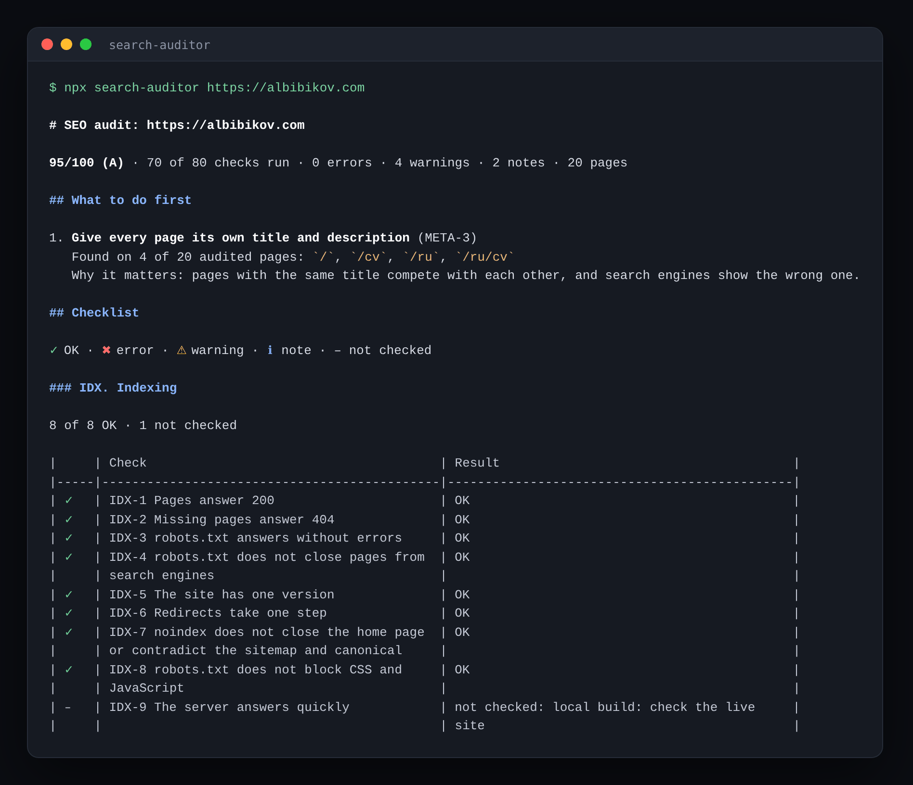

# search-auditor

[](https://www.npmjs.com/package/search-auditor) [](https://github.com/a-bibikov/search-auditor)

**Can Google, Bing and Yandex reach, index and show your site?** A technical SEO audit in one command: status codes, robots.txt, redirects, canonical, sitemap, titles and descriptions, headings, broken links, images, structured data, hreflang, HTTPS. 80 checks, each with what it costs and how to fix it.

```bash
npx search-auditor https://example.com
```



No sign-up, no API keys. Node.js 22.18+.

If it saved you time, a ⭐ on [GitHub](https://github.com/a-bibikov/search-auditor) helps other people find it.

## AI search

Whether ChatGPT, Claude and Perplexity can read and cite the site is checked by [ai-search-auditor](https://github.com/a-bibikov/ai-search-audit), with a report of its own: `npx ai-search-auditor https://example.com`. Both run on [auditor-engine](https://github.com/a-bibikov/auditor-engine), so the reports look the same.

## What it checks

80 checks in ten groups.

**IDX. Indexing**
- **IDX-1** Audited pages answer 200
- **IDX-2** A page that does not exist answers 404, and no «not found» page answers 200
- **IDX-3** robots.txt answers without errors: no 5xx or timeout (Google then treats the site as closed), plain-text rules, under 500 KB
- **IDX-4** robots.txt does not block the pages of the site — those in the sitemap and the audited ones — for Googlebot, Bingbot or Yandex
- **IDX-5** The site has one version: the other host (with or without www.) and the other trailing slash redirect to the main address
- **IDX-6** Redirects take one step: no chains, no loops
- **IDX-7** `noindex` does not close the home page and does not contradict the sitemap or the canonical
- **IDX-8** robots.txt does not block the CSS and JavaScript the page needs to render
- **IDX-9** The server answers quickly: first byte in under 0.8 s (live sites only)

**SEC. Security and HTTPS** (the connection checks need the live site)
- **SEC-1** The site is on https, and http:// redirects to it
- **SEC-2** Pages do not load anything over http://
- **SEC-3** The redirect from http:// is permanent (301 or 308), not a temporary 302
- **SEC-4** The certificate is trusted and does not expire within two weeks
- **SEC-5** HSTS tells browsers to use only https, for half a year at least
- **SEC-6** The site's own addresses use https://: links, canonical, hreflang, og tags, sitemap
- **SEC-7** Basic security headers: nosniff, frame protection, Referrer-Policy

**CAN. Canonical: the main address of each page**
- **CAN-1** Every page has a canonical
- **CAN-2** The canonical is an absolute address on this site
- **CAN-3** The canonical leads to a page that answers 200, not to an error or a redirect
- **CAN-4** One canonical per page: two different ones make Google ignore both
- **CAN-5** The canonical sits in `<head>`; one in `<body>` is ignored
- **CAN-6** The canonical in the HTML and in the `Link` header agree
- **CAN-7** Canonicals lead straight to the main page, not through another canonical
- **CAN-8** An address with UTM tags names the clean address as canonical
- **CAN-9** Language versions do not name each other as canonical

**MAP. Sitemap: the map of the site for search engines**
- **MAP-1** There is a sitemap, and robots.txt points to it
- **MAP-2** Sitemap addresses do not redirect
- **MAP-3** Sitemap pages are their own canonical
- **MAP-4** The sitemap file is valid: XML that answers 200, no bare &, within 50,000 addresses and 50 MB, every file of an index answers
- **MAP-5** Sitemap addresses are full and on this site
- **MAP-6** Pages the site links to are in the sitemap
- **MAP-7** Every sitemap address answers, including up to 50 beyond the audited sample
- **MAP-8** lastmod is honest: a W3C date, not in the future, not the same build time on every address

**META. Meta tags: how a page looks in search results**
- **META-1** Every page has a title of about 10–60 characters
- **META-2** Every page has a description of about 50–160 characters
- **META-3** Titles and descriptions are not repeated across pages
- **META-4** One title and one description per page
- **META-5** The title names the page, not a template: no «Home», «Untitled» or «React App»
- **META-6** The description adds to the title instead of repeating it
- **META-7** The page declares its encoding
- **META-8** The snippet is not forbidden with `nosnippet` or `max-snippet:0`
- **META-9** The site has a favicon

**STR. Page structure: headings, language, mobile**
- **STR-1** One H1 per page
- **STR-2** Heading levels do not skip
- **STR-3** The page declares its language
- **STR-4** Pages are set up for mobile
- **STR-5** Headings are not empty: an H1 that is only a logo reads as no H1
- **STR-6** The title and the H1 are about the same thing, or Google may rewrite the title
- **STR-7** The page can be zoomed on a phone
- **STR-8** `<html lang>` matches the language of the text
- **STR-9** The main content sits in `<main>`
- **STR-10** The page starts with `<!doctype html>`

**LNK. Links: how pages link to each other**
- **LNK-1** Internal links work
- **LNK-2** Internal links do not go through redirects
- **LNK-3** Every page is linked from another page: no orphans only the sitemap knows (with `--pages all`)
- **LNK-4** Links can be followed by a crawler: no `<a>` without href, `#` or `javascript:` for navigation
- **LNK-5** Internal links do not carry `nofollow`
- **LNK-6** Link text says where the link goes: no «read more», no image links without alt
- **LNK-7** Links to other sites still work: up to 30 checked, only 404, 410 and missing domains count as dead

**IMG. Images: image search and loading speed**
- **IMG-1** Images have alt text
- **IMG-2** Images have width and height, so the layout does not jump (CLS)
- **IMG-3** Lazy loading where it helps: not on the first image, yes on long pages
- **IMG-4** Photos are served in modern formats: WebP or AVIF, not JPEG and PNG only
- **IMG-5** Images open
- **IMG-6** Images are not heavier than 500 KB
- **IMG-7** Alt text describes the image: not a file name, «photo» or a paragraph

**DATA. Structured data: rich results**
- **DATA-1** JSON-LD has no syntax errors
- **DATA-2** Every block has a schema.org `@context`, every entity a `@type`
- **DATA-3** Rich-result types have the properties Google requires: Product, Event, BreadcrumbList, Recipe, VideoObject, LocalBusiness, JobPosting, Course, ratings and reviews
- **DATA-4** Nested pages have breadcrumbs (BreadcrumbList)
- **DATA-5** Addresses in the markup are full, dates are ISO 8601
- **DATA-6** The home page names the site with WebSite

**LANG. Language versions: hreflang for multilingual sites** (sites with hreflang)
- **LANG-1** hreflang codes are valid
- **LANG-2** Language versions point at each other
- **LANG-3** There is an x-default
- **LANG-4** Every version lists itself in hreflang
- **LANG-5** hreflang leads to working canonical pages: no redirects, errors or copies
- **LANG-6** The hreflang language matches the `<html lang>` of the page it points to
- **LANG-7** Each language is listed once
- **LANG-8** hreflang addresses are full

Levels: `error` — search engines cannot index the page or index the wrong one; `warn` — lowers rankings or clicks; `info` — a recommendation.

The report opens with the score and the number of errors, warnings and notes. Then what to do first: the three changes worth the most, each with what to do, on which pages it was found and why it matters. Then a table per group: every check with ✓ OK, ✖ error, ⚠ warning, ℹ note or – not checked, and what was found. It ends with one table of recommendations in checklist order, group by group: the check, its severity, what to do, and a comment on what was found where. A check that cannot run on a site — hreflang on a site in one language, HTTPS on a local build — is marked «not checked» with the reason, never as passed.

```
### META. Meta tags: how a page looks in search results

7 of 9 OK

|     | Check                                                        | Result                     |
|-----|--------------------------------------------------------------|----------------------------|
| ✓   | META-1 Every page has a title of the right length            | OK                         |
| ℹ   | META-2 Every page has a description of the right length      | 1 note · 1 of 20 pages     |
| ⚠   | META-3 Titles and descriptions are not repeated across pages | 4 warnings · 4 of 20 pages |
| ✓   | META-4 One title and one description per page                | OK                         |
| ✓   | META-5 The title names the page, not a template              | OK                         |
| ✓   | META-6 The description adds to the title                     | OK                         |
| ✓   | META-7 The page declares its encoding                        | OK                         |
| ✓   | META-8 The snippet is not forbidden                          | OK                         |
| ✓   | META-9 The site has a favicon                                | OK                         |
```

With `--json`, every finding reads on its own: what the check is, what was found against which norm, why it is a problem and how to fix it.

```json
{
  "rule": "META-2",
  "level": "info",
  "title": "Every page has a description of the right length",
  "where": "https://albibikov.com/ru/privacy",
  "message": "description of 165 characters, should be 50–160",
  "why": "Without a description search engines pick a random snippet, a long one is cut off mid-sentence, and fewer people click.",
  "fix": "Add `<meta name=\"description\">` of about 50–160 characters: what the page offers and why to open it."
}
```

**Score:** 100 minus 15 for each check with an error and 5 for each check with a warning; a warning that covers at least half of the audited pages costs 10. A ≥ 90, B ≥ 80, C ≥ 70, D ≥ 60, F below; if fewer than two thirds of the checks could run, the grade is capped at B.

## Usage

```bash
# A live site
npx search-auditor https://example.com

# A local build: requests go to localhost, the report shows public URLs
npx search-auditor http://127.0.0.1:3000 --base https://example.com

# Every page in the sitemap instead of a sample of 20
npx search-auditor https://example.com --pages all

# Report in Russian
npx search-auditor https://example.com --lang ru

# JSON for scripts and agents
npx search-auditor https://example.com --json --out report.json
```

| Option | |
|---|---|
| `--base <url>` | Public origin when auditing a local build |
| `--pages <n\|all>` | Pages to audit: a number sampled across templates (default 20), or `all` for every page in the sitemap |
| `--max-links <n>` | Internal links to request (default 100) |
| `--fail-on <level>` | Exit 1 on `error` (default), `warn` or `never` |
| `--lang <lang>` | Report language: `en` (default), `ru` |
| `--width <n>` | Fit tables into n characters; long cells wrap inside their column. Default: the terminal width in a terminal, plain Markdown in a file or a pipe; `0` turns wrapping off |
| `--json` | JSON instead of Markdown: each finding has its check `title`, the `message`, `why` it is a problem and how to `fix` it |
| `--out <file>` | Also write the report to a file |
| `--badge <file>` | Also write a score badge: `.svg` to show in a README, `.json` for a [shields.io endpoint](https://shields.io/badges/endpoint-badge). See [Badge](#badge) |
| `--config <file>` | Config file (default `search-auditor.config.json`) |
| `-v`, `--verbose` | Show progress |

Config:

```json
{
  "disable": ["STR-2", "IMG-4"],
  "maxPages": 20,
  "maxLinks": 100,
  "lang": "en"
}
```

`maxPages`: a number or `"all"`. With `"all"` every page in the sitemap is audited, so raise `maxLinks` too if you want every internal link checked.

In CI the Markdown report also goes to the job summary (`GITHUB_STEP_SUMMARY`).

## Badge

Show your score in your own README:

```bash
npx search-auditor https://example.com --badge seo-badge.svg
```

The command writes a badge like **SEO | 95/100**, colored by grade (A green … F red), and prints the line to paste:

```md
[](https://github.com/a-bibikov/search-auditor)
```

To keep the badge current, write it as JSON in CI (`--badge badge.json`), publish the file (GitHub Pages, your site, a gist) and show it through shields.io:

```md
[](https://github.com/a-bibikov/search-auditor)
```

## As a library

```js
import { auditSearch, toMarkdown } from "search-auditor";

const report = await auditSearch("https://example.com", { config: { lang: "en" } });
console.log(report.score, report.grade);
console.log(toMarkdown(report));
```

The crawl, the scoring and the report come from [auditor-engine](https://github.com/a-bibikov/auditor-engine). The checks are exported as `seoRules`, with `collect` for the extra requests they need, for your own runner.

## Example

[albibikov.com](https://albibikov.com), a Next.js site in English and Russian (20 pages, local production build): **95/100 (A)**, 70 of 80 checks run. The connection checks — HTTPS, the certificate, HSTS, the server speed — need the live site and are marked «not checked» on a local build; so are external links when the audit has no internet access.

| | Found |
|---|---|
| META-3 ⚠ | The same title on `/` and `/cv`, and on `/ru` and `/ru/cv` |
| META-2 ℹ | A description of 165 characters on `/ru/privacy`, should be 50–160 |
| DATA-6 ℹ | No WebSite with the site name on the home page |

## Roadmap

**PERF. Speed** — page weight, render-blocking scripts and styles, Core Web Vitals from the Chrome UX Report

**SOC. Link cards** — Open Graph and Twitter / X cards for every page

- **GitHub Action**, like the one of [ai-search-auditor](https://github.com/a-bibikov/ai-search-audit#github-action), with the report in the job summary
- **CI that reports only new problems,** with a file of accepted exceptions
- **SARIF output,** so findings show up in GitHub code scanning
- **HTML report** to share with people who do not read Markdown

Ideas are welcome in [issues](https://github.com/a-bibikov/search-auditor/issues); for pull requests see [CONTRIBUTING.md](CONTRIBUTING.md).

## License

MIT © [Aleksandr Bibikov](https://albibikov.com)
